# HGScripts

当前版本：**v0.3.7** · 2026-10-23

一个面向 Adobe 用户的脚本管理面板，用来集中管理、搜索、收藏、查看说明、编辑和运行脚本。当前以 Illustrator 为主，同时保留 Photoshop / InDesign 的基础支持。

最新版收录 **37 个 Illustrator 脚本**。下方按用途配有统一图标和简要说明，方便在安装前快速找到需要的工具。

## 下载与安装

### [下载 HGScripts v0.3.7 Windows 安装器](release/HGScripts_0.3.7/HGScripts-v0.3.7-Setup.exe?raw=1)

**只需下载这一个 `Setup.exe` 文件，无需下载整个仓库。** 安装器已包含所需的面板、脚本和插件文件。

1. 保存工作，并关闭正在运行的 Adobe 软件。
2. 点击上方链接，下载并运行 `HGScripts-v0.3.7-Setup.exe`，按提示完成安装。
3. 重新打开 Illustrator，在「窗口 > 扩展」中打开「海哥的Adobe脚本管理器」。

需要卸载时，再次运行同一个 `Setup.exe`，点击底部「卸载 HGScripts」；也可以通过 Windows「设置 > 应用 > 安装的应用」卸载。

[详细安装／卸载说明](HGScripts_0.3.7/docs/install_windows.md) · [安装包 SHA256 校验值](release/HGScripts_0.3.7/SHA256SUMS.txt)

## Illustrator 脚本目录

点击脚本名或「脚本」可查看对应 JSX；有详细说明的脚本可继续查看操作条件和注意事项。批量改色、自动清理类工具会直接修改文档，重要文件建议先保存副本。

### 颜色转换与遮罩

####  选择对象黑白互换.jsx

**纯黑与纯白互换**

将选中对象已有的纯黑填充、描边与纯白互换，灰色和彩色保持原样，不会新增填充或描边。

[脚本](HGScripts_0.3.7/cep/HGScripts/user_scripts/illustrator/选择对象黑白互换.jsx) · [详细说明](HGScripts_0.3.7/cep/HGScripts/user_scripts/illustrator/选择对象黑白互换.md)

---

####  单一色转其它色.jsx

**把取样同色对象改成自定义色**

以首个选中对象的单一颜色为样本，将文档中所有同色对象改成拾色器里选择的新颜色。

[脚本](HGScripts_0.3.7/cep/HGScripts/user_scripts/illustrator/单一色转其它色.jsx) · [详细说明](HGScripts_0.3.7/cep/HGScripts/user_scripts/illustrator/单一色转其它色.md)

---

####  单一色转自定义色_其它转自定义色.jsx

**分别替换样本色与其它颜色**

以首个选中对象取样，分别设置样本色和其它已有颜色的替换结果，适合快速制作双色稿。

[脚本](HGScripts_0.3.7/cep/HGScripts/user_scripts/illustrator/单一色转自定义色_其它转自定义色.jsx) · [详细说明](HGScripts_0.3.7/cep/HGScripts/user_scripts/illustrator/单一色转自定义色_其它转自定义色.md)

---

#### 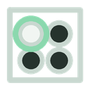 同色转白其余转黑.jsx

**按取样色生成白色区域遮罩**

以选中对象或编组的颜色取样，把当前画板中的同色区域转白，其余已有颜色转黑。

[脚本](HGScripts_0.3.7/cep/HGScripts/user_scripts/illustrator/同色转白其余转黑.jsx) · [详细说明](HGScripts_0.3.7/cep/HGScripts/user_scripts/illustrator/同色转白其余转黑.md)

---

#### 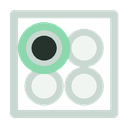 同色转黑其余转白.jsx

**按取样色生成黑色区域遮罩**

以选中对象或编组的颜色取样，把当前画板中的同色区域转黑，其余已有颜色转白。

[脚本](HGScripts_0.3.7/cep/HGScripts/user_scripts/illustrator/同色转黑其余转白.jsx) · [详细说明](HGScripts_0.3.7/cep/HGScripts/user_scripts/illustrator/同色转黑其余转白.md)

---

#### 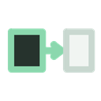 选择对象转白色.jsx

**选中对象转白**

将当前选中对象已有的填充和描边改成白色，不影响未选对象，也不会新增颜色通道。

[脚本](HGScripts_0.3.7/cep/HGScripts/user_scripts/illustrator/选择对象转白色.jsx) · [详细说明](HGScripts_0.3.7/cep/HGScripts/user_scripts/illustrator/选择对象转白色.md)

---

####  选择对象转自定义颜色.jsx

**选中对象自定义改色**

通过拾色器选择新颜色，替换当前选中对象已有的填充和描边；取消拾色器不会改色。

[脚本](HGScripts_0.3.7/cep/HGScripts/user_scripts/illustrator/选择对象转自定义颜色.jsx) · [详细说明](HGScripts_0.3.7/cep/HGScripts/user_scripts/illustrator/选择对象转自定义颜色.md)

---

#### 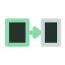 选择对象转黑色.jsx

**选中对象转黑**

将当前选中对象已有的填充和描边改成黑色，不影响未选对象，也不会新增颜色通道。

[脚本](HGScripts_0.3.7/cep/HGScripts/user_scripts/illustrator/选择对象转黑色.jsx) · [详细说明](HGScripts_0.3.7/cep/HGScripts/user_scripts/illustrator/选择对象转黑色.md)

---

#### 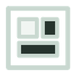 选择转白其余转黑.jsx

**按选区生成白色区域遮罩**

把当前画板内选中的对象转白，其它有颜色的对象转黑；按选区判断，不使用取样颜色。

[脚本](HGScripts_0.3.7/cep/HGScripts/user_scripts/illustrator/选择转白其余转黑.jsx) · [详细说明](HGScripts_0.3.7/cep/HGScripts/user_scripts/illustrator/选择转白其余转黑.md)

---

#### 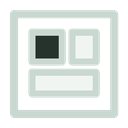 选择转黑其余转白.jsx

**按选区生成黑色区域遮罩**

把当前画板内选中的对象转黑，其它有颜色的对象转白；按选区判断，不使用取样颜色。

[脚本](HGScripts_0.3.7/cep/HGScripts/user_scripts/illustrator/选择转黑其余转白.jsx) · [详细说明](HGScripts_0.3.7/cep/HGScripts/user_scripts/illustrator/选择转黑其余转白.md)

---

####  填充色同步到描边色.jsx

**填充色复制到描边**

把选中对象的填充颜色同步到描边，让描边与填充一致，同时保留原填充。

[脚本](HGScripts_0.3.7/cep/HGScripts/user_scripts/illustrator/填充色同步到描边色.jsx) · [详细说明](HGScripts_0.3.7/cep/HGScripts/user_scripts/illustrator/填充色同步到描边色.md)

---

####  描边色同步到填充色.jsx

**描边色复制到填充**

把选中对象的描边颜色同步到填充，让填充与描边一致，同时保留原描边。

[脚本](HGScripts_0.3.7/cep/HGScripts/user_scripts/illustrator/描边色同步到填充色.jsx) · [详细说明](HGScripts_0.3.7/cep/HGScripts/user_scripts/illustrator/描边色同步到填充色.md)

---

### 选择与清理

#### 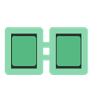 选择同色对象-严格版.jsx

**严格匹配填充、描边和颜色**

以首个选中对象为样本，选中填充与描边的有无状态、颜色都完全相同的对象；只改变选择，不改色。

[脚本](HGScripts_0.3.7/cep/HGScripts/user_scripts/illustrator/选择同色对象-严格版.jsx) · [详细说明](HGScripts_0.3.7/cep/HGScripts/user_scripts/illustrator/选择同色对象-严格版.md)

---

#### 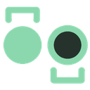 选择同色对象-宽松版.jsx

**按宽松单色规则选择**

以首个选中对象为样本，按更宽松的单色规则选择对象；单色样本不强制填充对填充、描边对描边。

[脚本](HGScripts_0.3.7/cep/HGScripts/user_scripts/illustrator/选择同色对象-宽松版.jsx) · [详细说明](HGScripts_0.3.7/cep/HGScripts/user_scripts/illustrator/选择同色对象-宽松版.md)

---

#### 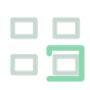 选择空对象_极速版.jsx

**快速选中无填充、无描边路径**

选中文档中没有填充和描边的空路径，便于检查后集中处理；脚本不会自动删除对象。

[脚本](HGScripts_0.3.7/cep/HGScripts/user_scripts/illustrator/选择空对象_极速版.jsx) · [详细说明](HGScripts_0.3.7/cep/HGScripts/user_scripts/illustrator/选择空对象_极速版.md)

---

#### 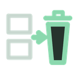 清理真正无用的空对象.jsx

**保守清理无效空对象**

自动删除确定无显示效果、无结构用途的空路径、空白文字和空组，保留剪切、参考线等有效对象。

[脚本](HGScripts_0.3.7/cep/HGScripts/user_scripts/illustrator/清理真正无用的空对象.jsx) · [详细说明](HGScripts_0.3.7/cep/HGScripts/user_scripts/illustrator/清理真正无用的空对象.md)

---

### 画板对齐与缩放

####  手选基准对齐画板-右对齐.jsx

**基准对象右对齐画板**

选中一个基准对象，移动其所属最外层父组，使基准对象右边对齐所在画板右边。

[脚本](HGScripts_0.3.7/cep/HGScripts/user_scripts/illustrator/手选基准对齐画板-右对齐.jsx) · [详细说明](HGScripts_0.3.7/cep/HGScripts/user_scripts/illustrator/手选基准对齐画板-右对齐.md)

---

#### 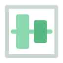 手选基准对齐画板-垂直居中.jsx

**基准对象垂直居中画板**

选中一个基准对象，移动其所属最外层父组，使基准对象垂直中心对齐所在画板垂直中心。

[脚本](HGScripts_0.3.7/cep/HGScripts/user_scripts/illustrator/手选基准对齐画板-垂直居中.jsx) · [详细说明](HGScripts_0.3.7/cep/HGScripts/user_scripts/illustrator/手选基准对齐画板-垂直居中.md)

---

####  手选基准对齐画板-左对齐.jsx

**基准对象左对齐画板**

选中一个基准对象，移动其所属最外层父组，使基准对象左边对齐所在画板左边。

[脚本](HGScripts_0.3.7/cep/HGScripts/user_scripts/illustrator/手选基准对齐画板-左对齐.jsx) · [详细说明](HGScripts_0.3.7/cep/HGScripts/user_scripts/illustrator/手选基准对齐画板-左对齐.md)

---

####  手选基准对齐画板-底部对齐.jsx

**基准对象底部对齐画板**

选中一个基准对象，移动其所属最外层父组，使基准对象底部对齐所在画板底部。

[脚本](HGScripts_0.3.7/cep/HGScripts/user_scripts/illustrator/手选基准对齐画板-底部对齐.jsx) · [详细说明](HGScripts_0.3.7/cep/HGScripts/user_scripts/illustrator/手选基准对齐画板-底部对齐.md)

---

#### 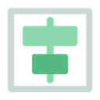 手选基准对齐画板-水平居中.jsx

**基准对象水平居中画板**

选中一个基准对象，移动其所属最外层父组，使基准对象水平中心对齐所在画板水平中心。

[脚本](HGScripts_0.3.7/cep/HGScripts/user_scripts/illustrator/手选基准对齐画板-水平居中.jsx) · [详细说明](HGScripts_0.3.7/cep/HGScripts/user_scripts/illustrator/手选基准对齐画板-水平居中.md)

---

####  手选基准对齐画板-顶部对齐.jsx

**基准对象顶部对齐画板**

选中一个基准对象，移动其所属最外层父组，使基准对象顶部对齐所在画板顶部。

[脚本](HGScripts_0.3.7/cep/HGScripts/user_scripts/illustrator/手选基准对齐画板-顶部对齐.jsx) · [详细说明](HGScripts_0.3.7/cep/HGScripts/user_scripts/illustrator/手选基准对齐画板-顶部对齐.md)

---

####  手选基准缩放.jsx

**按基准尺寸缩放整个父组**

输入目标宽度或高度，缩放基准对象所属最外层父组并保持其中心不动；同时填写宽高可非等比缩放。

[脚本](HGScripts_0.3.7/cep/HGScripts/user_scripts/illustrator/手选基准缩放.jsx) · [详细说明](HGScripts_0.3.7/cep/HGScripts/user_scripts/illustrator/手选基准缩放.md)

---

####  尺寸无小数.jsx

**宽高小数向上取整**

将选中对象带小数的宽或高去掉小数后加一，原本为整数的维度不变，默认保持对象中心。

[脚本](HGScripts_0.3.7/cep/HGScripts/user_scripts/illustrator/尺寸无小数.jsx) · [详细说明](HGScripts_0.3.7/cep/HGScripts/user_scripts/illustrator/尺寸无小数.md)

---

#### 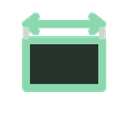 选择对象长边设为1024.jsx

**选区最长边等比缩放到 1024**

将当前选区作为一个整体等比缩放，使最长边变为 1024；多选时不会逐对象分别缩放。

[脚本](HGScripts_0.3.7/cep/HGScripts/user_scripts/illustrator/选择对象长边设为1024.jsx) · [详细说明](HGScripts_0.3.7/cep/HGScripts/user_scripts/illustrator/选择对象长边设为1024.md)

---

#### 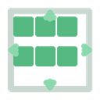 六个对象两行三列最大化.jsx

**六对象自动排版并尽量放大**

将 6 个对象按统一比例缩放，排成 2 行 3 列，并在当前画板内居中、尽量利用可用空间。

[脚本](HGScripts_0.3.7/cep/HGScripts/user_scripts/illustrator/六个对象两行三列最大化.jsx) · [详细说明](HGScripts_0.3.7/cep/HGScripts/user_scripts/illustrator/六个对象两行三列最大化.md)

---

### 位置与坐标

####  记录对象中心相对画板位置.jsx

**记录对象在画板中的相对位置**

记录选中对象或整体选区的几何中心相对所在画板的位置，供“应用位置”脚本重复使用。

[脚本](HGScripts_0.3.7/cep/HGScripts/user_scripts/illustrator/记录对象中心相对画板位置.jsx) · [详细说明](HGScripts_0.3.7/cep/HGScripts/user_scripts/illustrator/记录对象中心相对画板位置.md)

---

####  应用对象中心相对画板位置.jsx

**应用已记录的画板相对位置**

将当前选中对象或整体选区移动到已记录的画板相对位置，多选时保持对象之间的相对关系。

[脚本](HGScripts_0.3.7/cep/HGScripts/user_scripts/illustrator/应用对象中心相对画板位置.jsx) · [详细说明](HGScripts_0.3.7/cep/HGScripts/user_scripts/illustrator/应用对象中心相对画板位置.md)

---

####  ai坐标转其它_gemini.jsx

**坐标转换工具旧版**

读取选中对象并计算 AI 坐标、画板比例、UV、Octane 等参数；常规使用更推荐下方新版工具。

[脚本](HGScripts_0.3.7/cep/HGScripts/user_scripts/illustrator/ai坐标转其它_gemini.jsx) · [详细说明](HGScripts_0.3.7/cep/HGScripts/user_scripts/illustrator/ai坐标转其它_gemini.md)

---

####  AI坐标转换工具.jsx

**坐标、尺寸与 UV 参数转换**

读取选中对象的位置、尺寸和画板比例，转换成 UV、Octane 等参数，供渲染、贴图或其它软件使用。

[脚本](HGScripts_0.3.7/cep/HGScripts/user_scripts/illustrator/AI坐标转换工具.jsx) · [详细说明](HGScripts_0.3.7/cep/HGScripts/user_scripts/illustrator/AI坐标转换工具.md)

---

### 图形与画板

#### 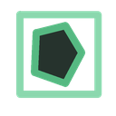 为选择对象创建外框.jsx

**创建选中对象的外接矩形**

按选中对象的可见范围创建无填充、白色描边的外框并选中它，原对象保留。

[脚本](HGScripts_0.3.7/cep/HGScripts/user_scripts/illustrator/为选择对象创建外框.jsx) · [详细说明](HGScripts_0.3.7/cep/HGScripts/user_scripts/illustrator/为选择对象创建外框.md)

---

####  选择对象上方创建白色矩形.jsx

**在选中对象上方覆盖白色矩形**

在首个选中对象的原位置创建同尺寸、白色无描边矩形并置于其上方，原对象保留。

[脚本](HGScripts_0.3.7/cep/HGScripts/user_scripts/illustrator/选择对象上方创建白色矩形.jsx)

---

####  当前画板创建黑色背景矩形.jsx

**创建画板大小的黑色背景**

在当前画板创建等大的黑色无描边矩形并放到底层；重复运行会新增背景，不会替换已有背景。

[脚本](HGScripts_0.3.7/cep/HGScripts/user_scripts/illustrator/当前画板创建黑色背景矩形.jsx) · [详细说明](HGScripts_0.3.7/cep/HGScripts/user_scripts/illustrator/当前画板创建黑色背景矩形.md)

---

####  复制选择对象到新画板.jsx

**复制对象到右侧同尺寸新画板**

在当前画板右侧新建同尺寸画板，把选中对象复制到相同相对位置并选中新副本，原对象保留。

[脚本](HGScripts_0.3.7/cep/HGScripts/user_scripts/illustrator/复制选择对象到新画板.jsx) · [详细说明](HGScripts_0.3.7/cep/HGScripts/user_scripts/illustrator/复制选择对象到新画板.md)

---

### 导出与生产

#### 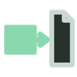 导出选择对象为长边1024AI.jsx

**导出长边 1024 的独立 AI 素材**

将选中对象缩放到长边 1024，导出为画板适配对象的新 AI 文件，不直接覆盖原文档。

[脚本](HGScripts_0.3.7/cep/HGScripts/user_scripts/illustrator/导出选择对象为长边1024AI.jsx) · [详细说明](HGScripts_0.3.7/cep/HGScripts/user_scripts/illustrator/导出选择对象为长边1024AI.md)

---

####  纸杯展开.jsx

**生成可编辑的纸杯杯身展开图**

根据上下口直径和实际高度 H 或斜坡长度 S 生成杯身轮廓，支持搭接、出血、辅助线和尺寸标注。

[脚本](HGScripts_0.3.7/cep/HGScripts/user_scripts/illustrator/纸杯展开.jsx) · [详细说明](HGScripts_0.3.7/cep/HGScripts/user_scripts/illustrator/纸杯展开.md)

---

#### 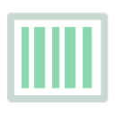 生成UPC-A条形码.jsx

**生成可编辑的矢量 UPC-A 条形码**

在当前画板中心生成矢量条码，支持输入 11 位数字自动计算校验位，或输入 12 位数字生成。

[脚本](HGScripts_0.3.7/cep/HGScripts/user_scripts/illustrator/生成UPC-A条形码.jsx) · [详细说明](HGScripts_0.3.7/cep/HGScripts/user_scripts/illustrator/生成UPC-A条形码.md)

## v0.3.7 更新

- **修复运行报错**：修复运行脚本后统计行的 `formatElapsed is not defined` 报错，运行记录与耗时统计恢复正常。
- **界面缩放**：设置页可选 100%–200% 界面缩放，立即生效并自动保存，高分辨率屏幕文字偏小时可调大。
- **中文输入法恢复**：安装器不再按系统缩放写入 `--force-device-scale-factor`，固定为 `1`，配合界面缩放使用。

查看 [完整更新日志](HGScripts_0.3.7/CHANGELOG.md) 和 [本版说明](HGScripts_0.3.7/docs/release_notes_0.3.7.md)。

## 兼容与使用

本版面向 Windows。Illustrator 2023–2026 提供各年份匹配的统一 AIP 加速插件；Illustrator 2021 保留有限 CEP / JSX 支持，不提供 AIP。Illustrator 2020 不在兼容目标内，macOS 暂不支持。

纸杯工具当前为 JSX，真实宿主验收覆盖 Illustrator 2026。它生成杯身展开图，不含卷口、杯底和封底工艺余量；打印时使用 100% / 实际大小，先打样核对。

## 源码与图标维护

本版公开内容在 [HGScripts_0.3.7](HGScripts_0.3.7/)：包含面板、JSX、用户说明及编译好的 AIP，不包含 C++ 源码、Adobe SDK、VS 工程、调试符号或本机运行数据。

README 图标由 [build_script_icons.py](tools/build_script_icons.py) 使用同一套 64×64 几何图元生成，产物位于 `assets/script-icons`。新增或调整脚本后运行以下命令，可重新生成 SVG、透明 PNG、总预览和清单，并自动核对脚本目录是否完整：

```powershell
python tools/build_script_icons.py
```

## 反馈

作者：[@haigeplay3d](https://github.com/haigeplay3d)。反馈时请提供 Adobe 版本、操作步骤和错误现象。
